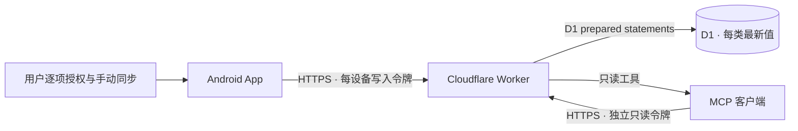

# CanaryMCP

[中文](#中文) | [English](#english)

## 中文

CanaryMCP 是一个 Android 设备上下文采集器与 Cloudflare Remote MCP 服务。Android 端只在用户逐类授权、并手动点按同步时上传上下文；Worker 通过每设备令牌鉴权，D1 仅保存每类最新快照，MCP 客户端只能读取与该令牌绑定的设备数据。

> **当前状态：首个实现阶段，尚未发布。** 仓库包含 Android、Worker、D1 migration、测试和手动部署工作流；真实 Cloudflare 部署与 Android 真机验证尚未在此仓库环境完成。无障碍服务属于高敏感且受分发平台约束的能力，请在分发前核对平台政策及产品实际用途。

### 数据流



### 功能与数据范围

- **电量：** 电量百分比与充电状态；无需系统权限，但须单独开启分享。
- **位置：** 初次只请求大致位置。精确位置是另一个独立开关；关闭精确选项时，App 不选 GPS provider 并网格化坐标。没有后台位置权限或轨迹采集。
- **应用使用情况：** 最近 24 小时最多 15 个活跃应用的包名、前台时长和最近使用时间；需要用户在 Android 特殊访问设置中手动允许。
- **无障碍树快照：** 默认关闭，需用户在系统设置中启用服务，并在 App 内按一次“采集下一屏”；服务仅在随后一次切换到其他窗口时抓取单个有限深度快照，采集成功后自动解除武装，且两分钟未采集时会超时取消。密码节点文本会过滤，但其他屏幕文字仍可能敏感。该能力仅作实验性实现，可能不符合某些应用商店的无障碍服务规则。
- **网络上传：** 没有后台定时同步。用户点按同步时才读取已开启的类别并通过 HTTPS 上传；关闭类别会尝试删除服务端对应快照。
- **保留：** D1 每台设备、每个类别只存一份最新快照；七天后 API/MCP 不再返回该快照，Worker 每日物理清理过期行。可以手动删除全部快照或撤销设备。

更详细的数据分类和处理说明见 [`DATA-PRIVACY.md`](DATA-PRIVACY.md)。

### 仓库结构

- `src/`：Cloudflare Worker API、MCP Streamable HTTP 端点与校验逻辑。
- `migrations/`：D1 数据库 schema。
- `Android/`：Kotlin、Jetpack Compose、Material 3 手机 App。
- `.github/workflows/deploy-worker.yml`：GitHub Actions 手动一键部署 Worker 与 D1。

### 本地运行 Worker

要求 Node.js 20+。在仓库根目录：

```bash
npm ci
cp .dev.vars.example .dev.vars
# 编辑 .dev.vars，填写仅用于本地的长随机 PAIRING_SECRET
npm run db:local
npm run dev
```

Worker 默认地址为 `http://localhost:8787`。Android 模拟器 Debug 版可通过 `http://10.0.2.2:8787` 连接；仅 Debug 变体允许这几个 loopback 地址使用 HTTP，Release 仍强制 HTTPS。本地测试数据库与线上 D1 分离。健康检查：`GET /health`。

### 部署到 Cloudflare

1. 在 GitHub 仓库设置中添加 Actions **变量** `CLOUDFLARE_ACCOUNT_ID`。
2. 添加 Actions **密钥** `CLOUDFLARE_API_TOKEN`（需 Cloudflare Workers Scripts Edit 与 D1 Edit 权限），以及 `CANARYMCP_PAIRING_SECRET`（高熵随机值）。真实密钥只保存在 GitHub/Cloudflare 密钥存储中，不写入仓库。
3. 打开 GitHub **Actions → Deploy Worker → Run workflow**。工作流会检查、测试 Worker，按需创建 `canary-mcp-db`，应用 D1 migrations，将配对密钥写入 Worker secret，并部署 Worker。
4. 首次部署后取得 `https://canary-mcp.<你的子域>.workers.dev` 地址，在 Android App 中填写它与配对密钥完成设备配对。

工作流需要目标 Cloudflare 账号已启用 Workers 和 D1。失败时查看对应 Action 日志；日志不应包含配对密钥或访问令牌。工作流仅手动触发，不会因每次 push 自动生产部署。

### Android App

使用 Android Studio 打开 [`Android/`](Android/) 工程。界面按 [Material 3](https://m3.material.io/) 与 [Jetpack Compose Material 3](https://developer.android.com/develop/ui/compose/designsystems/material3) 实现，支持 Android 12+ 动态配色。需要 Android SDK 35 与 JDK 17。构建命令：

```bash
cd Android
./gradlew assembleDebug
```

App 的 Worker 地址填根 URL（不要追加 `/mcp`）。配对后，Android Keystore 会分别加密保存设备写入令牌和 MCP 只读令牌；在 MCP 客户端配置 Worker 的 `/mcp` 地址，并将只读令牌作为 `Authorization: Bearer <token>` 请求头。App 提供显式“复制 MCP 令牌”操作，令牌应只交给你信任的 MCP 客户端。

### MCP 工具

- `read_device_context`：读取该令牌所属设备某个类别或全部尚未过期的最新快照。
- `get_device_status`：返回设备标签、可用类别及过期时间，不返回上下文值。

没有任意 SQL、跨设备查询或写入工具。REST 设备 API 供 Android 配对、上传与删除使用，所有读取都受每设备 Bearer Token 约束。

### 验证

```bash
npm run typecheck
npm test
npx wrangler deploy --dry-run
```

Worker 单元测试不等同于 Cloudflare 生产集成测试。Android 构建需在具备 Android SDK 的环境运行；上线前还要做真机权限撤回、D1 部署、MCP 客户端握手和无障碍服务政策检查。

### 项目文档

- [`DATA-PRIVACY.md`](DATA-PRIVACY.md)：数据范围、授权、保留与撤回。
- [`SECURITY.md`](SECURITY.md)：安全报告流程与当前未完成项。
- [`CONTRIBUTING.md`](CONTRIBUTING.md)：贡献指南。
- [`PRE-RELEASE-CHECKLIST.md`](PRE-RELEASE-CHECKLIST.md)：公开发布检查。
- [`CHANGELOG.md`](CHANGELOG.md)：变更记录。
- Apache-2.0，版权声明见 [`LICENSE`](LICENSE)。

---

## English

CanaryMCP combines an Android device-context collector with a Cloudflare Remote MCP service. The Android app uploads only categories the user has individually enabled, and only after a manual sync action. The Worker authenticates per-device bearer tokens; D1 stores only the latest snapshot per category, and MCP clients can read only the device bound to their token.

> **Status: first implementation phase; not released.** This repository now contains Android and Worker source, a D1 migration, tests, and a manual deployment workflow. A real Cloudflare deployment and Android device validation have not been performed from this workspace. Accessibility-service use is highly sensitive and may be restricted by distribution platforms; verify the applicable policies and actual product purpose before distribution.

### Data flow and privacy

The app separately gates battery, approximate/precise location, app usage, and an experimental one-shot accessibility snapshot. There is no background location permission or scheduled sync. Turning a category off stops future uploads and requests deletion of that category's cloud snapshot. Each device/category has one latest D1 row; API/MCP stops returning it after seven days and a daily job physically removes expired rows. See [`DATA-PRIVACY.md`](DATA-PRIVACY.md).

### Repository layout

- `src/`: Cloudflare Worker API, MCP Streamable HTTP endpoint, and validation.
- `migrations/`: D1 schema.
- `Android/`: Kotlin, Jetpack Compose, Material 3 app.
- `.github/workflows/deploy-worker.yml`: one-click manual GitHub Actions deployment.

### Run the Worker locally

Requires Node.js 20+. From the repository root:

```bash
npm ci
cp .dev.vars.example .dev.vars
# Edit .dev.vars with a local-only random PAIRING_SECRET
npm run db:local
npm run dev
```

The local Worker listens at `http://localhost:8787`; its local D1 database is separate from production. Health check: `GET /health`.

### Deploy to Cloudflare

Add the GitHub Actions variable `CLOUDFLARE_ACCOUNT_ID` and secrets `CLOUDFLARE_API_TOKEN` (Workers Scripts Edit and D1 Edit) and `CANARYMCP_PAIRING_SECRET` (a high-entropy random value). Then run **Actions → Deploy Worker → Run workflow**. The workflow verifies the Worker, creates the production D1 database if needed, applies migrations, sets the pairing secret, and deploys. It runs only when manually dispatched.

### Android and MCP client setup

Open `Android/` in Android Studio with Android SDK 35 and JDK 17. The UI follows [Material 3](https://m3.material.io/) and [Jetpack Compose Material 3](https://developer.android.com/develop/ui/compose/designsystems/material3), including Android 12+ dynamic colors. Run `./gradlew assembleDebug`. In the app, enter the Worker root URL and pairing secret. Android Keystore stores separate device-write and MCP-read-only tokens. Configure an MCP client to POST to `<worker-url>/mcp` with `Authorization: Bearer <mcp-read-only-token>`. The app copies only this read-only token after an explicit user action; share it only with a trusted MCP client.

MCP tools are `read_device_context` (read non-expired snapshots for the paired device) and `get_device_status` (category availability and expiry metadata only). There is no arbitrary SQL, cross-device query, or MCP write tool.

### Checks

```bash
npm run typecheck
npm test
npx wrangler deploy --dry-run
```

Worker unit tests are not a production Cloudflare integration test. Run Android builds in an environment with the Android SDK and complete device permission-revocation, D1 deployment, MCP handshake, and accessibility-policy checks before release.

The project is licensed under Apache-2.0; see [`LICENSE`](LICENSE). Contributions and release requirements are documented in [`CONTRIBUTING.md`](CONTRIBUTING.md) and [`PRE-RELEASE-CHECKLIST.md`](PRE-RELEASE-CHECKLIST.md).
